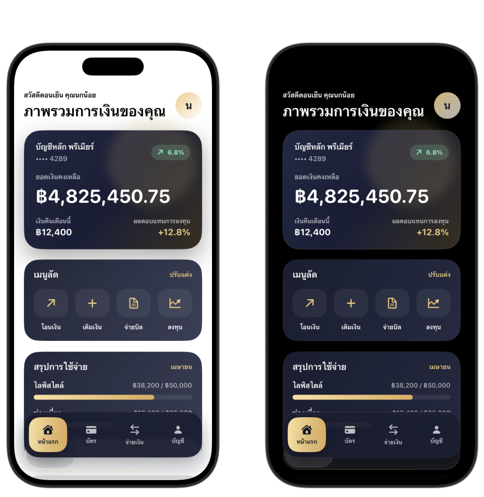

# LuxeBank

Premium iOS banking app (SwiftUI) with a Spring Boot + Kotlin backend.

- Specification: [docs/SPEC.md](docs/SPEC.md)
- Threat model: [docs/security/threat-model.md](docs/security/threat-model.md)
- API contract: [api/openapi.yaml](api/openapi.yaml)

## Screenshots
<p align="center">
  
</p>

## Repository layout

```
ios/            SwiftUI app (XcodeGen project in ios/project.yml)
backend/        Spring Boot 3 + Kotlin, PostgreSQL, Redis, Flyway
api/            OpenAPI contract shared by iOS and backend
docs/           Specification and security documents
docker-compose.yml  Local stack: postgres + redis + backend
```

## Requirements

- Xcode with an iOS 17+ simulator
- `brew install xcodegen swiftlint openjdk@21 colima docker docker-compose`

## iOS

```bash
cd ios
xcodegen generate
open LuxeBank.xcodeproj
```

Run the `LuxeBank` scheme on an iPhone simulator. By default the app uses mock repositories. To use the local backend, add the launch argument `-LuxeBankAPI http://127.0.0.1:8080` (Debug builds allow `localhost` only).

Demo customer (synthetic, local profile only): national ID `1-2345-67890-12-1`, password `LuxeDemo#2026`, OTP `000000`.

Tests (unit + UI onboarding flow):

```bash
xcodebuild test -project ios/LuxeBank.xcodeproj -scheme LuxeBank -destination 'platform=iOS Simulator,name=iPhone 18 Pro'
```

Run the UI flow against the real backend:

```bash
TEST_RUNNER_LUXEBANK_API=http://127.0.0.1:8080 xcodebuild test -project ios/LuxeBank.xcodeproj -scheme LuxeBank -destination 'platform=iOS Simulator,name=iPhone 18 Pro' -only-testing:LuxeBankUITests
```

## Backend

Start Docker (Colima):

```bash
colima start
```

Run the whole stack:

```bash
docker compose up -d --build
```

Health check: `curl http://127.0.0.1:8080/actuator/health`

Build, lint (ktlint, detekt) and test (Testcontainers):

```bash
cd backend && ./gradlew build
```

With Colima, Testcontainers needs:

```bash
export DOCKER_HOST=unix://$HOME/.colima/default/docker.sock TESTCONTAINERS_DOCKER_SOCKET_OVERRIDE=/var/run/docker.sock
```

## CI

GitHub Actions run on every pull request: iOS tests + SwiftLint, backend build + tests + 70% coverage gate, and the security gates from spec 13.4.3 (gitleaks, Semgrep, Trivy, CodeQL).
