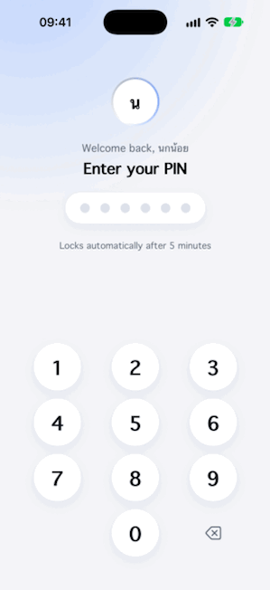

<div align="center">


# LuxeBank

**A premium mobile banking app for iPhone, with a double-entry banking backend.**

[](https://github.com/flupxscop/LukeBankApp/actions/workflows/ios.yml)
[](https://github.com/flupxscop/LukeBankApp/actions/workflows/backend.yml)
[](https://github.com/flupxscop/LukeBankApp/actions/workflows/security.yml)
[](https://github.com/flupxscop/LukeBankApp/actions/workflows/codeql.yml)

SwiftUI · iOS 17+ · Spring Boot 4 · Kotlin · PostgreSQL · Redis

<br/>

<a href="docs/demo/luxebank-promo.mp4">
  
</a>

<sub>▶ Watch the 44-second film</sub>

</div>

---

## Overview

LuxeBank is a full-stack retail banking product: a SwiftUI app in Thai and English, and a Spring Boot API built around
a double-entry ledger. It is built as a **simulation** — every external system (SMS, interbank transfers, PromptPay,
bill payment, card processing, push notifications) is a stub — while the core behaves as a real bank's would: money
moves only through balanced ledger entries, every payment is idempotent and signed by a key in the iPhone's Secure
Enclave, and every sensitive action is audited.

Each external system sits behind a port, so it can be replaced by a real provider one at a time without touching
business logic. See [From simulation to a real system](docs/integration-guide.md).

<p align="center">
  
  &nbsp;&nbsp;
  
</p>

## Try the demo

No Apple Developer account is needed: the app's mock bank runs entirely on the device.

- **Watch:** the [film](docs/demo/luxebank-promo.mp4) at the top, or the recording below it, which walks through PIN
  unlock, the home screen, a PromptPay transfer to its slip, cards and the profile. Re-record with
  `scripts/record-demo.sh` and re-render the film with `scripts/make-promo.sh`.
- **Try it in a browser:** `scripts/build-demo.sh` produces `dist/LuxeBank-demo-simulator.zip`, an unsigned
  simulator build that services such as [Appetize.io](https://appetize.io) run in any browser. Upload it as an iOS
  app and share the link.
- **Run it on a Mac:** follow [Getting started](#getting-started); a free Apple ID is enough for the simulator.

Demo login: national ID `1-2345-67890-12-1`, password `LuxeDemo#2026`, OTP `000000`, then any 6-digit PIN that is
not a sequence or a repeated digit. Face ID is not available in a browser, so transfers of ฿50,000 or more cannot be
confirmed there.

## Features

| Area | What the app does |
|---|---|
| **Onboarding & security** | Register with national ID, password and SMS OTP; bind one iPhone; 6-digit PIN and Face ID; auto-lock; App Switcher privacy; jailbreak detection |
| **Accounts & history** | Balances, wealth chart, spending insights and budgets; searchable, filterable transaction history with categories |
| **Transfers & payments** | Own accounts, other LuxeBank customers, other banks and PromptPay; bill payment and top-ups; Thai QR scanning; slips with a verification QR; Face ID from ฿50,000 |
| **Cards** | Debit and credit cards with a simulated statement; freeze, spending channels and daily limits; reveal the full number with Face ID; report lost and replace |
| **Profile & notifications** | Relationship manager, settings (PIN, Face ID, language, notification preferences), registered devices; in-app inbox for every money movement and security event |
| **Resilience** | Offline mode with the last data shown; WCAG AA contrast, Dynamic Type and VoiceOver support |

## Architecture

```
┌──────────────────────────┐   HTTPS + certificate pinning   ┌────────────────────────────────────────┐
│ iOS app (SwiftUI, MVVM)  │ ──────────────────────────────▶ │ Spring Boot API  /api/v1               │
│  Features → ViewModels   │   JWT + device-key signatures   │  auth · accounts · ledger · payments   │
│  Repository protocols    │                                 │  cards · notifications · audit         │
│   ├ Remote (API)         │                                 │                                        │
│   └ Mock (offline demo)  │                                 │  Ports ──▶ stub adapters (simulation)  │
└──────────────────────────┘                                 └───────────┬───────────────┬────────────┘
                                                                         │               │
                                                             PostgreSQL 16 (Flyway)   Redis 7
                                                             double-entry ledger,     challenges,
                                                             append-only audit log    rate limits
```

**Design principles**

- **The ledger is the only writer of money.** Postings are append-only and must sum to zero; the database rejects
  unbalanced entries and negative customer balances.
- **Inquiry → confirm.** The server fixes amount and recipient at inquiry; confirmation carries only the inquiry ID,
  an idempotency key and a signature from the device key, plus the PIN or Face ID.
- **Deny by default.** Every query is scoped to its owner and answers `404` for anything else (BOLA).
- **Swappable integrations.** `luxebank.integrations.*` selects each adapter; the `prod` profile refuses to start
  while any stub is active.

| Layer | Technology |
|---|---|
| iOS | Swift, SwiftUI, Observation, Swift Testing, XCTest/XCUITest, XcodeGen, SwiftLint, MetricKit |
| Backend | Kotlin 2.3, Spring Boot 4.1 (MVC, Security, Data JPA, JDBC templates), Jackson 3, Flyway, JDK 21 |
| Data | PostgreSQL 16, Redis 7 |
| Quality | JUnit 5, Testcontainers, JaCoCo (70 % gate), ktlint, detekt |
| Security | Secure Enclave keys, SPKI pinning, gitleaks, Semgrep, Trivy, CodeQL |

## Getting started

### Prerequisites

- macOS with **Xcode 26 or later** and an iOS 17+ simulator
- Homebrew packages:

```bash
brew install xcodegen swiftlint openjdk@21 colima docker docker-compose
```

### Run the iOS app (no backend needed)

The app ships with mock repositories, so it runs on its own:

```bash
cd ios
xcodegen generate
open LuxeBank.xcodeproj
```

Run the **LuxeBank** scheme on an iPhone simulator and sign in with the demo customer:

| Field | Value |
|---|---|
| National ID | `1-2345-67890-12-1` |
| Password | `LuxeDemo#2026` |
| OTP | `000000` |

All demo data is synthetic.

### Run the full stack

1. Start Docker and create your local secrets file (git ignores `.env`):

   ```bash
   colima start
   cp .env.example .env        # then set your own DB_PASSWORD
   ```

2. Start PostgreSQL, Redis and the API:

   ```bash
   docker compose up -d --build
   curl http://127.0.0.1:8080/actuator/health
   ```

   The `local` profile seeds the demo customer with accounts, a year of transaction history, payees, saved bills
   and cards.

3. Point the app at the backend: in Xcode, add the launch argument `-LuxeBankAPI http://127.0.0.1:8080`
   (Debug builds allow `localhost` only).

To run the API outside Docker, export the same variables first:

```bash
cd backend
set -a; source ../.env; set +a
./gradlew bootRun --args='--spring.profiles.active=local'
```

## Configuration

| Setting | Where | Purpose |
|---|---|---|
| `DB_PASSWORD` | `.env` | Local PostgreSQL password (required; see `.env.example`) |
| `luxebank.integrations.{otp,interbank,promptpay,bills,cards,push}` | `application.yml` | `stub` today; set a provider name once its adapter exists |
| `LUXEBANK_PEPPER`, `LUXEBANK_IDENTITY_KEY`, JWT keys | environment / KMS | Required in production; no defaults outside the `local` profile |
| `LUXEBANK_API_BASE_URL`, `LUXEBANK_API_PINS` | iOS build settings | Required for Release builds (HTTPS URL and at least two SPKI pins); the app refuses to start without them |

### Simulation behaviour

| Scenario | How to trigger it |
|---|---|
| Recipient not found / rejected by the other bank | Account or PromptPay numbers ending in `0000` / `9999` (nothing is deducted) |
| Internal transfer to another customer | Account `222-3-33444-5` |
| Unknown bill | A reference of all zeros |
| Face ID step-up | Any transfer of ฿50,000 or more |
| Push notification banner | `xcrun simctl push booted com.luxebank.app ios/PushSamples/money-in.apns` |
| Compromised phone / offline mode | Debug launch arguments `-SimulateCompromisedDevice` / `-SimulateOffline` |

## Testing

```bash
# iOS — unit and UI tests
xcodebuild test -project ios/LuxeBank.xcodeproj -scheme LuxeBank \
  -destination 'platform=iOS Simulator,name=iPhone 18 Pro'

# Backend — build, lint (ktlint, detekt), tests (Testcontainers) and coverage gate
cd backend && ./gradlew build
```

With Colima, Testcontainers also needs:

```bash
export DOCKER_HOST=unix://$HOME/.colima/default/docker.sock
export TESTCONTAINERS_DOCKER_SOCKET_OVERRIDE=/var/run/docker.sock
```

| Suite | Scope |
|---|---|
| Backend (100+ tests) | Ledger invariants and concurrency, payment flows, BOLA, lockouts, token rotation, log masking, performance budgets |
| iOS unit (110+ tests) | View models, repositories, PIN rules, pinning, contrast ratios |
| iOS UI | Onboarding, history, transfers, bills, cards, profile, offline, compromised device, accessibility audit |
| Measurements | `scripts/measure-app.sh`: launch, responsiveness, memory, CPU, disk and app size |
| Demo | `scripts/record-demo.sh` records the walk-through, `scripts/make-promo.sh` renders the film, `scripts/build-demo.sh` builds the browser demo |

Run the UI tests against the real backend with `TEST_RUNNER_LUXEBANK_API=http://127.0.0.1:8080`.

## Continuous integration

Every pull request runs:

- **iOS** — SwiftLint (strict), unit and UI tests
- **Backend** — build, ktlint, detekt, tests, 70 % coverage gate
- **Security gates** — gitleaks (secrets), Semgrep (SAST), Trivy (dependencies and container image)
- **CodeQL** — static analysis of the backend

## Project structure

```
.
├── ios/                 SwiftUI app (XcodeGen: ios/project.yml)
│   ├── LuxeBank/        App, Core, Data (Remote + Mock), Domain, Features, DesignSystem
│   ├── LuxeBankTests/   Unit tests (Swift Testing)
│   └── LuxeBankUITests/ UI, accessibility and measurement tests
├── backend/             Spring Boot API (Kotlin), Flyway migrations, integration tests
├── api/openapi.yaml     API contract shared by app and backend
├── docs/                Specification, security, hardening and metrics reports
├── scripts/             Tooling: measure-app.sh, record-demo.sh, make-promo.sh, build-demo.sh
├── docker-compose.yml   Local stack: PostgreSQL, Redis, API
└── .env.example         Template for local secrets
```

## Documentation

| Document | Contents |
|---|---|
| [Specification](docs/SPEC.md) | Requirements, screens, data model, API design and decisions (Thai) |
| [API contract](api/openapi.yaml) | OpenAPI 3.1 definition of `/api/v1` |
| [Threat model](docs/security/threat-model.md) | STRIDE analysis and mitigation status |
| [Hardening report](docs/hardening-report.md) | Security-test traceability, accessibility, performance, UAT checklist |
| [App quality metrics](docs/app-quality-metrics.md) | Stability, speed and resource targets and results |
| [Integration guide](docs/integration-guide.md) | What is simulated and how to connect real providers |

## Security

LuxeBank is a simulation and must not hold real customer data or money. The security model — device binding,
Secure Enclave signatures, certificate pinning, ledger constraints, audit chain and log masking — is documented in
the [threat model](docs/security/threat-model.md). Never commit secrets: local values belong in `.env`, production
values in a secrets manager.

## License

No license has been chosen yet; all rights are reserved by the author.
